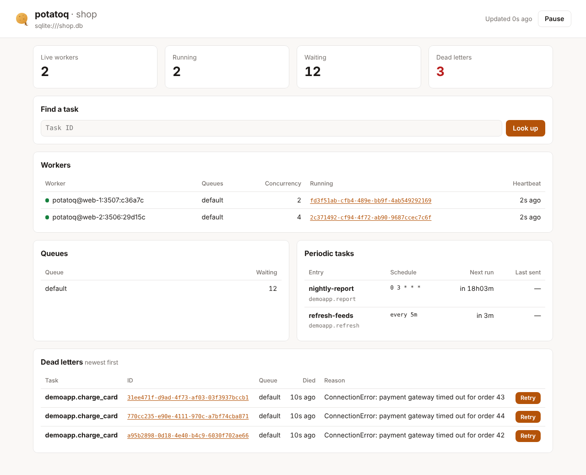

# Dashboard

A web page with what Flower shows you most: live workers and what they're running,
queue sizes, periodic tasks and when they run next, dead letters you can replay or delete, and the
details of any task by ID. It's part of `pip install potatoq`, with no extra
dependencies, and works with every broker.



## Run it

```console
$ potatoq -A proj dashboard
 dashboard   🥔 http://127.0.0.1:5555/ for redis://localhost:6379/0
```

| Option | Default | |
|---|---|---|
| `--host` | `127.0.0.1` | Address to listen on. Use `0.0.0.0` (with `--auth`) to reach it from other machines |
| `--port` | `5555` | Flower's port, so existing bookmarks and firewall rules keep working |
| `--auth user:password` | off | HTTP basic auth. `POTATOQ_DASHBOARD_AUTH` keeps the password out of `ps` |
| `--read-only` | off | Hide the retry, delete and revoke buttons, and refuse those requests |

The page refreshes every 3 seconds. It reads the same data as `potatoq status`, `queues`,
`schedule` and `dead list`, straight from the broker, so it works as soon as it starts
and shows the same thing on every machine. It needs no worker of its own and no events.

!!! warning "Protect it"
    The dashboard shows task arguments and can replay, delete and revoke tasks. It listens on
    localhost unless you pass `--host`, and warns when you listen elsewhere without
    `--auth`. Behind a reverse proxy, put it under your usual login instead.

## Mount it in your web app

The dashboard is a WSGI app (`Dashboard(app)`) with an ASGI version (`.asgi`), so it can
live under a path of the app you already run and use its login.

=== "Django"

    ```python
    # urls.py
    urlpatterns = [
        path("ops/potatoq/", include("potatoq.contrib.django.dashboard")),
        ...
    ]
    ```

    Only staff users get in (`is_staff`, like the Django admin); everyone else is sent
    to `LOGIN_URL`. Set `POTATOQ_DASHBOARD_READ_ONLY = True` to hide the actions.

=== "FastAPI / Starlette"

    ```python
    from potatoq.dashboard import Dashboard

    fastapi_app.mount("/ops/potatoq", Dashboard(potatoq_app).asgi)
    ```

    Add your own authentication in front of the mount, for example a middleware that
    checks the session for that path.

=== "Flask"

    ```python
    from werkzeug.middleware.dispatcher import DispatcherMiddleware

    from potatoq.dashboard import Dashboard

    flask_app.wsgi_app = DispatcherMiddleware(
        flask_app.wsgi_app, {"/ops/potatoq": Dashboard(potatoq_app, auth=("ops", password))}
    )
    ```

=== "gunicorn / uWSGI"

    ```python
    # dashboard.py
    import os

    from potatoq.dashboard import Dashboard
    from proj.celery import app

    application = Dashboard(app, auth=("ops", os.environ["DASHBOARD_PASSWORD"]))
    ```

    ```console
    $ gunicorn dashboard:application --bind 0.0.0.0:5555
    ```

`Dashboard(app, read_only=True, auth=("user", "password"))` takes the same options as
the command. Leave `auth` out when your framework already guards the path.

## What it shows

- **Summary**: live workers, running tasks, waiting tasks and dead letters.
- **Workers**: each live worker's queues, processes × threads, the IDs of the tasks it's
  running right now, and how long ago its heartbeat arrived (amber when it's late).
- **Queues**: tasks waiting in each queue, including ones scheduled for later (on
  RabbitMQ, those wait in the delay queues and aren't counted until they're due).
- **Periodic tasks**: every `beat_schedule` entry, when it runs next, and when it was
  last sent (not on RabbitMQ, which keeps no record of sent runs).
- **Dead letters**: the newest 100, with the reason. **Retry** sends one back to its
  queue, like `potatoq dead retry`. **Delete** forgets one for good when it should never
  run again, like `potatoq dead delete`. Both ask first.
- **A task by ID**: its state, arguments, timings, worker, and its result or traceback.
  A task that hasn't started yet can be **revoked**. Click any task ID on the page to
  open it.

## The JSON API

The page reads a small JSON API under the dashboard's path. Use it for scripts and
health checks:

| Request | Returns |
|---|---|
| `GET api/overview` | workers, queue sizes, dead-letter count, periodic tasks |
| `GET api/dead?limit=100` | dead letters, newest first, with arguments and reason |
| `GET api/tasks/<id>` | what the result backend and the queue know about a task |
| `POST api/dead/<id>/retry` | replay a dead letter |
| `POST api/dead/<id>/delete` | delete a dead letter for good |
| `POST api/tasks/<id>/revoke` | revoke a task that hasn't started |

The `POST` requests need an `X-Potatoq-Dashboard: 1` header. Browsers can't send it from
another site without CORS, which is what protects the actions from cross-site requests.

## Compared with Flower

Flower builds its view from Celery's event stream, so it needs events turned on (`-E`),
and it only knows what happened while it was running. The potatoq dashboard reads the
broker and the result backend, so there is nothing to enable and nothing is lost when it
restarts.

What it doesn't have yet:

- **A history of every task** with search and filters. Without an event stream there's
  no list of everything that ran; look a task up by ID instead.
- **Charts** of throughput and runtimes. [Prometheus metrics](../wishlist.md#monitoring-and-operations)
  are planned for that.
- **Worker control** (shutting workers down, resizing pools, rate limits). Use your
  process manager and `SIGTERM`/`SIGHUP`.
